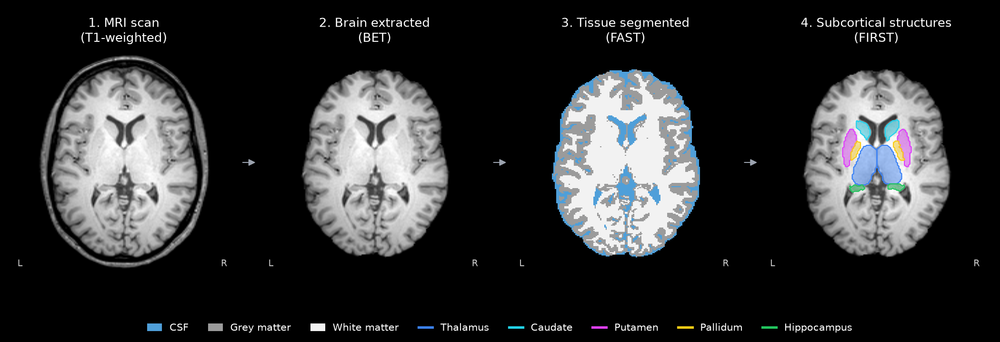
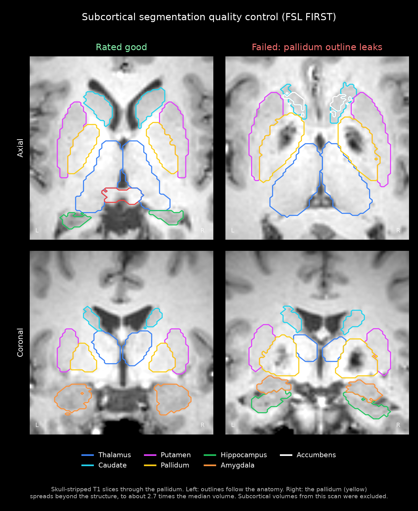
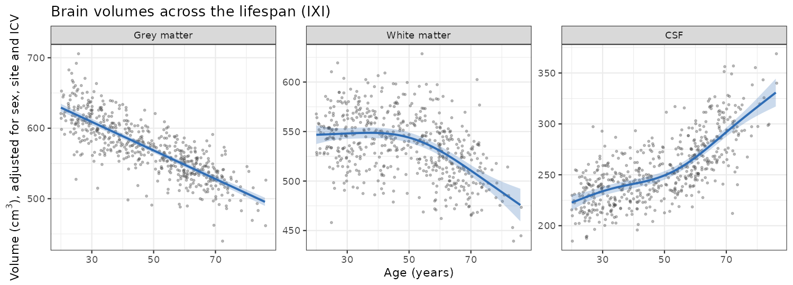
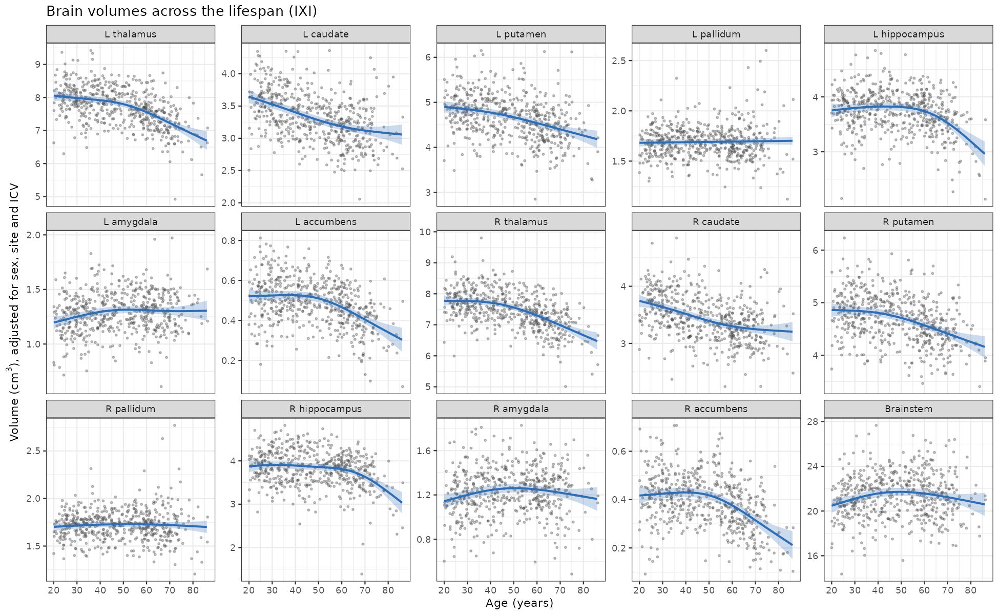
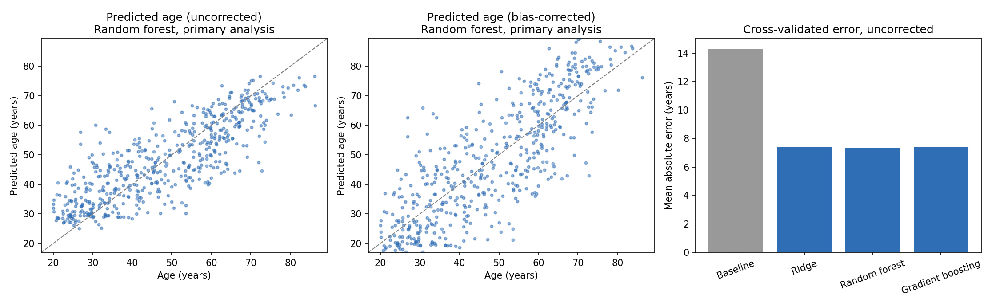
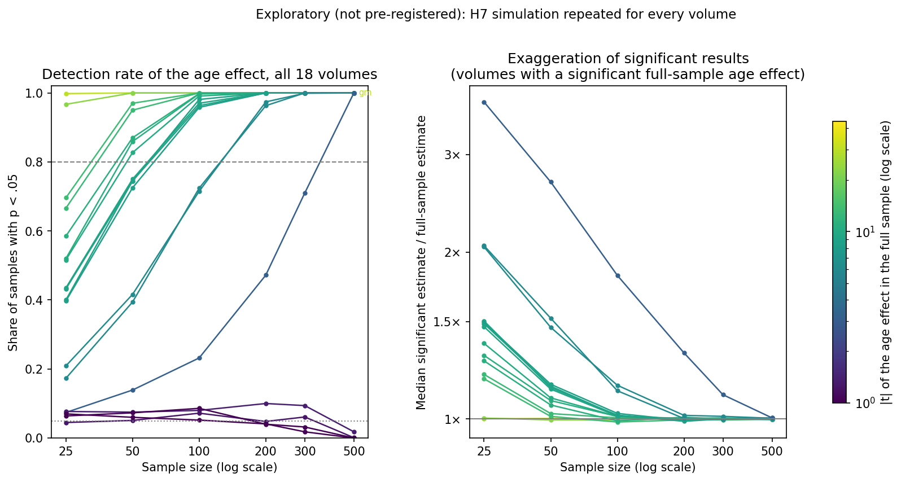
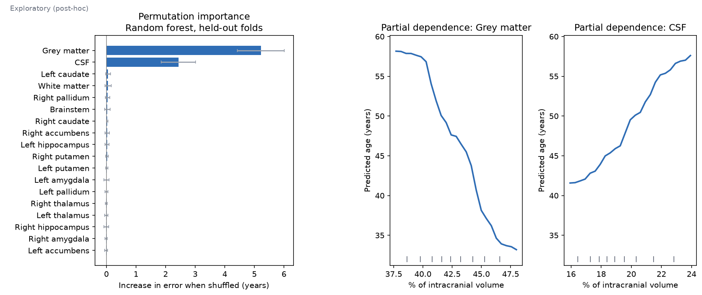

# Brain changes across the lifespan: estimating age from MRI

How does brain volume change from young adulthood to late adulthood, and can a machine-learning model predict a participant's age from their brain scan? This project answers both questions with a reproducible analysis pipeline applied to 563 publicly available brain MRI scans from three London hospitals.

Status: pre-registered analysis complete (8 October 2026). H1-H5 are supported, H6 is not supported, and H7 is technically met but uninformative (hypotheses and abbreviations are defined in [Terms and abbreviations](#terms-and-abbreviations), and details are in [Results](#results)). The analysis plan was pre-registered in [PREREGISTRATION.md](PREREGISTRATION.md) before any models were run.

How to read this README. Each section opens with a short plain-language summary (In short), followed by the full technical detail for researchers. Terms and abbreviations are defined in [Terms and abbreviations](#terms-and-abbreviations). A fully non-technical version is in [README_PLAIN_LANGUAGE.md](README_PLAIN_LANGUAGE.md).

## Terms and abbreviations

The seven hypotheses (written down in [PREREGISTRATION.md](PREREGISTRATION.md) before any analysis):

- H1: Grey matter volume declines with age.
- H2: White matter volume rises into midlife, then declines.
- H3: Cerebrospinal fluid (CSF) volume rises with age, faster after 60.
- H4: Hippocampus and thalamus volumes decline with age, faster after 60.
- H5: A brain age model predicts age better than a baseline that assigns every participant the mean age.
- H6: The brain age model is less accurate on a hospital it wasn't trained on.
- H7: Small studies detect the grey matter-age effect less often and overestimate it when they do (the "winner's curse").

Brain anatomy:

- Grey matter: brain tissue made mostly of nerve cell bodies, where information is processed.
- White matter: bundles of nerve fibres that carry signals between brain regions.
- CSF: fluid in and around the brain. Its volume grows as brain tissue shrinks.
- Subcortical structures: groups of grey matter deep inside the brain. The thalamus relays sensory signals, the caudate, putamen and pallidum are involved in movement and coordination, the accumbens in reward, the hippocampus in memory, the amygdala in emotion, and the brainstem connects the brain and spinal cord. L and R mean left and right.
- Intracranial volume (ICV): total volume inside the skull, used to adjust for head size.
- Atrophy: shrinkage of brain tissue.

Scans and processing:

- MRI: magnetic resonance imaging, a scanner that uses magnetic fields to image the body without radiation.
- T1 scan (T1-weighted): a type of MRI scan that shows grey matter, white matter and CSF with good contrast, used to measure brain structure.
- IXI: Information eXtraction from Images, the open-access dataset of about 600 healthy adults' scans used here, from Guy's Hospital (Guy's), Hammersmith Hospital (HH) and the Institute of Psychiatry (IOP) in London.
- Site: the hospital where a scan was taken. Each used a different scanner.
- FSL: FMRIB Software Library, free and widely used software for analysing brain scans.
- BET: Brain Extraction Tool (FSL), which removes the skull and scalp from the image.
- FAST: FMRIB's Automated Segmentation Tool (FSL), which labels each voxel as grey matter, white matter or CSF.
- FIRST: FMRIB's Integrated Registration and Segmentation Tool (FSL), which outlines the 15 subcortical structures.
- SIENAX: Structural Image Evaluation using Normalisation of Atrophy, cross-sectional (FSL), which estimates head size.
- Voxel: a 3D pixel, the smallest unit of a brain image.
- cm³: cubic centimetres (the same as millilitres), the unit for volumes.

Quality control:

- QC: quality control, meaning checking each scan's processing for errors before analysis.
- Visual rating (0 / 1 / 2): each scan's outlines were rated good (0), minor issue (1, kept) or failure (2, excluded).
- Blind rating: scans were rated under random codes, so age, sex and hospital couldn't influence the rating.
- Test-retest: 50 scans were rated a second time to check that ratings are consistent.
- Cohen's kappa: a measure of rating agreement that corrects for agreement by chance (0 = chance, 1 = perfect).
- CNR / SNR: contrast-to-noise and signal-to-noise ratios, which measure image quality (higher means clearer).
- Robust z-score: how unusual a value is compared with the others, measured in a way that extreme values don't distort (MAD = median absolute deviation).

Study design and statistics:

- Pre-registration: writing down the hypotheses and analysis plan before seeing the results, so they can't be changed to fit the data.
- Deviation: a change from the pre-registered plan, reported with its reason.
- Blind analysis / shuffled data: all code was written and tested on a copy of the data with age, sex and hospital shuffled between participants, so no real result could steer it.
- Unblinding: linking the QC ratings to the real data once all rating was finished.
- Sensitivity analysis: repeating an analysis with a different reasonable choice (for example, stricter QC) to check the result doesn't depend on it.
- ComBat: a statistical method that removes differences between scanners while keeping real effects such as age.
- GAM: generalized additive model, a regression that fits smooth curves instead of straight lines, used for the lifespan curves (R package mgcv).
- p-value; FDR: the p-value is the chance of a result at least this strong if there were no real effect. FDR (false discovery rate) correction adjusts p-values when many structures are tested at once.
- Brain age: the age a model predicts from someone's brain volumes. The brain age gap is predicted minus real age.
- Ridge regression, random forest, gradient boosting: three machine-learning model types used to predict age (Python package scikit-learn).
- Baseline: a benchmark that predicts the training set's average age for all participants without using any brain data. The age-prediction models must perform better than the baseline to show that brain volumes help predict age.
- MAE: mean absolute error, the average size of a prediction's error, in years.
- Nested cross-validation: repeatedly training on a sample of the data and testing on the remainder, with model settings tuned only on training data, so the test scores are honest.
- Leave-one-site-out: training on two hospitals and testing on the third, to check the model works on an unseen scanner.
- Bias correction: a standard adjustment for brain age models' tendency to overestimate young participants' ages and underestimate older participants' ages.
- Detection rate: the share of simulated studies that find an effect (p < .05), also called statistical power.
- Winner's curse: small studies that do find an effect tend to overestimate its size.

## Main findings

- Brain volume decreases with age steadily from 20 to 86. Grey matter decreases by about 20 cm³ (3.5%) per decade. White matter peaks in the late 30s and then declines, and cerebrospinal fluid (CSF) increases twice as fast after 60. The hippocampus, a structure involved in memory, is stable until about 60 and then loses about 8% per decade.
- A machine-learning model can estimate age from 18 brain volumes to within 7.4 years on average. This is around half the error of a baseline that assigns every participant the mean age. The model is also accurate on scans from hospitals it has never been trained on.
- Small studies produce misleading results. With 25 participants, a real hippocampus-age effect is detected in only about 20% of studies, and when it is, its size is overestimated about twofold.
- The analysis was pre-registered and run blind. Quality control was rated without knowing which participant and hospital the scan came from, and all code was tested on a shuffled copy of the data before the real results were viewed. Every result is reported.

## How the study was done

In short: The brain scans were measured with standard imaging software, the predictions and analysis plan were written down before any results were seen, every scan was checked for software errors without knowing who it belonged to, and all code was tested on scrambled data before the real analysis was run.

1. Get the data. Brain scans and ages from the free IXI dataset (563 adults, ages 20-86, three London hospitals).
2. Measure the brain. FSL removed the skull from each image, labelled grey matter, white matter and CSF, and outlined 15 subcortical structures, which were then measured in cm³.
3. Write the plan first. Seven hypotheses and the exact tests were pre-registered in [PREREGISTRATION.md](PREREGISTRATION.md) before any analysis.
4. Check quality, blind. Every scan's processing was rated by eye under random codes, so age, sex and hospital were unknown during rating.
5. Test the code on scrambled data. All analysis code was written and tested on a copy of the data with age, sex and hospital shuffled between participants (blind analysis).
6. Run the real analysis. Lifespan curves (GAMs), brain age models with nested cross-validation, and a small-sample simulation.

*The processing steps on one axial slice (above the eyes) of a single scan: the T1 image, the skull removed (BET), each voxel labelled as CSF, grey matter or white matter (FAST), and the subcortical structures outlined (FIRST).*

### Pipeline: scripts and tools

- Step 1, check demographics and pick a pilot sample: `scripts/01_check_demographics.py` (Python, pandas).
- Step 2, process T1 scans (reorient, crop, brain extraction, tissue and subcortical segmentation, volumes): `scripts/02_process_t1.sh` (Bash, FSL: BET, FAST, FIRST).
- Step 3, automated QC flags and review sheets: `scripts/03_qc_flags.py` (Python, pandas, NumPy, Pillow).
- Step 3b, rerun FIRST on flagged scans: `scripts/04_rerun_first.sh` (Bash, FSL).
- Step 4a, QC images for every scan and image quality (CNR, SNR): `scripts/05_qc_images_metrics.sh` (Bash, FSL).
- Step 4b, blinded rating sheets (random codes, shuffled order): `scripts/06_rating_sheets.py` (Python, Pillow).
- Step 4c, head size (SIENAX scaling factor): `scripts/07_sienax.sh` (Bash, FSL SIENAX).
- Step 4d, browser-based blind rating tool: `scripts/08_rating_tool.py` (Python standard library, Pillow).
- Step 4e, unblind the QC ratings, with reliability and exclusion report: `scripts/14_unblind.py` (Python, pandas, scikit-learn).
- Step 4f, review scans with extreme subcortical volumes (per-structure outlines): `scripts/14b_volume_flag_review.py` (Python, nibabel, matplotlib).
- Step 5a, analysis dataset (real, or shuffled for blind analysis): `scripts/09_build_dataset.py` (Python, pandas).
- Step 5b, QC rules and ComBat harmonisation for each analysis: `scripts/10_harmonise.py` (Python, neuroCombat).
- Step 6, lifespan models, H1-H4: `scripts/11_lifespan_gams.R` (R, mgcv, ggplot2).
- Step 7, brain age model, H5-H6: `scripts/12_brain_age.py` (Python, scikit-learn, statsmodels).
- Step 7b, redraw the brain age figure from saved results: `scripts/12b_brainage_figure.py` (Python, matplotlib).
- Step 8, sample size and the winner's curse, H7: `scripts/13_sample_size.py` (Python, NumPy, SciPy, matplotlib).
- Step 8b, exploratory H7 simulation for all 18 volumes: `scripts/13b_sample_size_all_structures.py` (Python, NumPy, SciPy, matplotlib).
- Step 9, SQLite database and example queries: `scripts/15_build_database.py` and `sql/` (Python sqlite3, SQL).
- Step 10, post-hoc checks (baseline choice, head size and the sex effect): `scripts/16_posthoc_checks.py` (Python, statsmodels).
- Step 11, brain image figures (processing steps, good vs failed segmentation): `scripts/17_brain_image_figures.py` (Python, nibabel, matplotlib).
- Step 12, exploratory extra models (SVR, Gaussian process, neural network), feature importance, learning curve and outlier detection: `scripts/18_exploratory_ml.py` (Python, scikit-learn, matplotlib).

Rating rules are in [QC_RATING_GUIDE.md](QC_RATING_GUIDE.md). The SQLite database (step 9) is a supporting extra and isn't part of the pre-registered analysis.

## Quality-control decisions made before unblinding (6 October 2026)

In short: Scans with a failed whole-brain measurement were removed. Scans with only failed deep-brain outlines kept their whole-brain measurements. A second, blind look at every failure reduced the number of whole-brain failures from 72 to 18, and both versions of the ratings are analysed.

- Primary analysis: follows the pre-registered rule. Scans with a whole-brain rating of 2 are excluded. Scans with a subcortical rating of 2 keep their whole-brain volumes but have subcortical volumes set to missing.
- Second look at failures: every scan rated 2 was re-checked blind, and the fail was kept only if the error would change volumes by more than a few percent. First-pass ratings are kept in `data/qc_ratings_firstpass.csv`, and every change is logged in `data/qc_review_log.csv`. Whole-brain fails decreased from 72 to 18 out of 563 participants (3.2%), and subcortical fails decreased from 16 to 6 (1.1%).
- Added sensitivity analyses: since many ratings were adjusted after review, the main models will also be run (a) with the 18 whole-brain-fail scans included and (b) with the 72 first-pass exclusions applied. This was decided before ratings were linked to subject IDs and before any outcome analysis.

## Quality control after unblinding (8 October 2026)

In short: The ratings were consistent where it mattered (whether a scan failed), visual checks caught errors the automatic checks missed, and a review of unusually large or small measurements found 7 more software errors. In total, 18 of 563 scans (3.2%) were removed and 13 more had their deep-brain measurements removed.

Rating reliability. 50 randomly chosen scans were re-rated under new codes 2 days after the main rating:

- Whole brain: exact agreement 64%, kappa 0.22 (linear-weighted 0.22), fail-vs-keep agreement 96%.
- Subcortical: exact agreement 72%, kappa 0.46 (linear-weighted 0.47), fail-vs-keep agreement 98%.

Fail-versus-keep decisions, which determine exclusions, were highly consistent (96-98%). The distinction between "good" (0) and "minor issue" (1) was not, but both are retained, so it affects only the "exclude 1s" sensitivity analysis.

Visual vs automatic QC. 14 of the 18 whole-brain failures had passed the automatic flags, so the automatic flags can't replace visual rating. Failed scans had lower image quality (median within-site CNR z -0.54 vs 0.08), and four low-quality Guy's scans rated 0 or 1 were retained, as image quality is not an exclusion criterion (rule 4).

Review of extreme volumes. As pre-registered, flags trigger review and do not exclude automatically. After unblinding, 11 scans rated 0 or 1 had a subcortical volume more than 5 robust z from the median. Since the rating snapshots showed each hemisphere in one colour, these scans were redrawn with each structure outlined separately (`scripts/14b_volume_flag_review.py`) and failed only if the outline clearly left the structure. The review saw subject IDs and volumes but no ages, sexes or results (`data/qc_volume_review.csv`):

- Fail (7): the outline clearly leaves the structure. Pallidum in IXI131, IXI483 and IXI527; hippocampus and brainstem in IXI094 and IXI292; brainstem in IXI056; amygdala in IXI586.
- Keep (4): IXI482, IXI204 and IXI470 (large pallidum) and IXI072 (small right hippocampus). The outlines follow the visible anatomy.

*Skull-stripped slices through the pallidum. Left: a scan rated good, where the outlines follow the anatomy. Right: one of the seven failures confirmed in the review. The pallidum outline (yellow) spreads over neighbouring tissue, and its volume is about 2.7 times the median. Its subcortical volumes were removed and its whole-brain volumes were kept.*

Confirmed failures have their subcortical rating set to 2 (subcortical volumes missing, whole-brain volumes kept). This is applied to both the reviewed and first-pass ratings, so the first-pass sensitivity analysis doesn't reintroduce known segmentation failures.

Final exclusions by site:

- Guy's: 314 scans, 12 excluded, 302 kept, 5 kept with subcortical volumes removed.
- Hammersmith: 181 scans, 6 excluded, 175 kept, 6 kept with subcortical volumes removed.
- IOP: 68 scans, 0 excluded, 68 kept, 2 kept with subcortical volumes removed.
- Total: 563 scans, 18 excluded (3.2%), 545 kept, 13 kept with subcortical volumes removed (2.4% of kept).

Excluded means whole-brain processing failed (rated 2), so the scan was dropped from all analyses (pre-registered exclusion rule 1). Subcortical volumes removed means the scan was kept for whole-brain analyses, but its 15 subcortical volumes were set to missing because the subcortical outlines failed (rule 3): 6 from the visual rating and 7 from the extreme-volume review. Full report: `results/real/qc_report.txt`.

## Results

In short: Five of the seven predictions were confirmed, one was not (the age model worked just as well on an unfamiliar hospital), and one was technically met but uninformative. Every result held when the analysis was repeated in different reasonable ways.

Numbers below come from the main analysis of 545 scans (531 for subcortical structures) unless otherwise stated. Full estimates with 95% intervals are in `results/real/gam_results.csv`. All hypothesis results remained unchanged when the analysis was repeated under alternative assumptions, including stricter quality control, exclusion of one hospital, and no scanner harmonisation.

- H1, grey matter declines with age: supported.
- H2, white matter peaks in midlife, then declines: supported.
- H3, CSF rises, faster after 60: supported.
- H4, hippocampus and thalamus decline, faster after 60: supported (all four structures).
- H5, brain age model beats a mean-age baseline: supported.
- H6, brain age accuracy is worse on an unseen site: not supported.
- H7, small samples detect the grey matter-age effect less often and overestimate it: met by the rule, but uninformative (ceiling effect, explained below).

### Lifespan models (H1-H4)

In short: The brain gradually loses volume with age. Grey matter shrinks steadily, white matter holds until the late 30s and then declines, CSF increases, and the hippocampus (involved in memory) stays stable until about 60 and then shrinks.

- Grey matter (H1) declined approximately linearly across the age range, by about 20 cm³ (3.5%) per decade, a total loss of 134 cm³.
- White matter (H2) peaked at about age 37 (95% interval 20-44) and then declined, with the rate increasing after 60 (-4 to -21 cm³ per decade). The peak estimate is imprecise, but the pre-registered criteria were met.
- CSF (H3) increased throughout adulthood, with the rate roughly doubling after 60 (+11 to +25 cm³ per decade).
- Hippocampal volume (H4) was stable until about 60, then declined by about 0.3 cm³ (about 8%) per decade in each hemisphere. Thalamic volume (H4) declined throughout, accelerating after 60 (-0.12 to -0.33 cm³ per decade per hemisphere).

Exploratory: the caudate, putamen and accumbens also declined with age (FDR-corrected p < .001). The pallidum showed no age effect (p ≈ .5 in both hemispheres). This should be interpreted cautiously, as FIRST segments the pallidum least reliably (3 of the 7 failures in the extreme-volume review). Brainstem volume increased slightly until about 50 and then declined, which fits its high white-matter content.

### Brain age model (H5-H6)

In short: A computer model estimated participants' ages from 18 brain measurements to within about 7.4 years on average, half the error of a mean-age baseline, and it worked about as well on scans from a hospital it had never seen.

Mean absolute error (years) and correlation with age for each model:

- Baseline (training-set mean age for every participant): 14.31 years.
- Ridge regression: 7.41 years, correlation 0.82.
- Random forest (best): 7.37 years, correlation 0.82.
- Gradient boosting: 7.39 years, correlation 0.82.

H5 was supported. All models halved the baseline error (Wilcoxon signed-rank test across 50 paired outer folds, p < .001), and the result was consistent across sensitivity analyses (best-model MAE 7.2-7.4 years). The three algorithms performed almost identically, which suggests the predictive information is in the volumes and the model choice matters little. Published models using voxel-level features typically achieve 3-5 years. This model used 18 regional volumes.

A median-age baseline, which minimises absolute error, would be the stricter comparison. Here it gives the same error as the mean (14.25 years; `scripts/16_posthoc_checks.py`).

Bias correction increased the error to 8.8-9.2 years, which is why H5 was evaluated on uncorrected predictions (deviation 4).

H6 was not supported under either the pre-registered or the refined rule. Mean absolute error for each test site, trained on the other two sites and trained within the site, with skill (1 - model error / baseline error) in brackets:

- Guy's (n = 297): 7.86 years trained on the other sites (skill 0.44) and 7.20 years trained within the site (skill 0.48).
- Hammersmith (n = 168): 7.29 years (skill 0.50) and 7.56 years (skill 0.49).
- IOP (n = 66): 7.33 years (skill 0.53) and 8.91 years (skill 0.37).

The model generalised well to scanners it hadn't been trained on. Accuracy decreased slightly only for Guy's and improved for IOP. However, the two settings differ in training-set size as well as scanner (about 60 training scans within IOP versus about 465 across the other sites), so the comparison cannot fully separate scanner effects from sample size. The results suggest that differences between these three scanners had little effect on a volume-based model.

Exploratory brain-age-gap analyses (bias-corrected gap from the best model, adjusted for age; `results/real/brainage_exploratory.txt`):

- Men had a 5.2-year older brain age than women (95% CI 3.2 to 7.1), with or without ComBat. This is partly a methodological artefact. Features were volumes divided by intracranial volume, men's intracranial volume is on average 14% larger, and brain volumes do not scale proportionally with head size. Adding intracranial volume to the model (post hoc; `scripts/16_posthoc_checks.py`) reduced the difference to 2.9 years (0.5 to 5.4), and intracranial volume itself predicted an older brain age (+12.7 years per litre). Roughly 40% of the sex difference therefore comes from head size, and it should not be interpreted as faster brain ageing in men.
- Lower image quality was associated with an older brain age (CNR, p < .001), which is why image quality is reported for every scan.
- Age was underestimated in the oldest participants (mean error 11.2 years over age 80, n = 8). This is the regression toward the mean typical of brain age models.

### Sample size and the winner's curse (H7)

In short: The planned test couldn't show the problem because the grey matter-age effect is too strong. Repeating it for all 18 brain measures showed that small studies often miss weaker effects and exaggerate them when they do find them.

Pre-registered result: criteria met, but uninformative. The grey matter-age effect was so strong (-2.0 cm³ per year, p ≈ 10⁻¹¹⁸) that even samples of 25 detected it 99.8% of the time. H7's criteria were technically met, but the test hit a ceiling and could not show small-sample bias. The pre-registered simulation is in `results/real/fig_sample_size.png`.

Exploratory follow-up (added after the H7 result). The simulation was repeated for all 18 volumes (`scripts/13b_sample_size_all_structures.py`). Analysing every volume, instead of one weak effect chosen after the fact, avoids selective reporting.

For five of the volumes, this is the full-sample age effect (t), the detection rate at n = 25 and n = 100, and how much significant n = 25 estimates overstate the effect:

- Grey matter: t = -30.1, detected 100% at n = 25 and 100% at n = 100, overstated 1.00x.
- Thalamus (R): t = -13.3, detected 70% and 100%, overstated 1.18x.
- Putamen (L): t = -8.7, detected 40% and 96%, overstated 1.49x.
- Hippocampus (L): t = -6.1, detected 21% and 72%, overstated 2.04x.
- Amygdala (L): t = +3.1, detected 7% and 23%, overstated 3.73x.

Weaker effects showed a clear winner's curse. At n = 25, the hippocampus-age effect was detected in about one sample in five, and significant estimates were about twice the full-sample value. For effects near zero in the full sample (pallidum, right amygdala, brainstem), significant results occurred at roughly the 5% false-positive rate and often had the wrong sign. There are two limitations. The models are linear, so non-monotonic effects (such as the brainstem) appear weak. At n = 500 each sample contains almost the entire dataset, so results converge on the full-sample estimate.

### Exploratory machine-learning checks (post-hoc)

In short: These checks were added after the results were known and are not pre-registered. Three further model types, including a neural network, matched the pre-registered models, and a simple linear regression on just grey matter and CSF did equally well, so the age information is in those two volumes and the algorithm matters little. The models relied almost entirely on grey matter and CSF, their error levelled off at about 240 training scans, and automatic outlier detection flagged the subcortical segmentation failures but not the whole-brain ones.

All checks use the primary analysis scans (n = 531) with the same features, ComBat step and cross-validation folds as the pre-registered brain age model (`scripts/18_exploratory_ml.py`; full output in `results/real/exploratory_ml.txt`).

MAE in years, with the paired-fold difference from random forest (50 folds) where it was tested:

- Gaussian process regression: 7.32 (-0.05, p = 0.22).
- Random forest (pre-registered best): 7.37.
- Neural network (MLP): 7.37 (+0.01, p = 0.53).
- Gradient boosting: 7.39.
- Ridge: 7.41.
- Grey matter + CSF only (linear regression): 7.41 (+0.05, p = 0.42).
- Support vector regression: 7.73 (+0.36, p < 0.001).
- Grey matter only (linear regression): 8.69 (+1.32, p < 0.001).
- Mean-age baseline: 14.31.

- Model choice: six model families spanning linear, tree-based, kernel and neural network approaches fell within 0.1 year of each other, except SVR, which was slightly worse.
- Stronger baselines: the mean-age baseline only shows that a model learns something. Two tougher baselines show how much the 18-volume models add. A linear regression on grey matter alone reached 8.7 years, and on grey matter and CSF together 7.4 years, matching every machine-learning model. Most of the brain age signal in these features is captured by two volumes, and the other 16 and the more complex algorithms add essentially nothing.
- Leave-one-site-out: recomputing H6 with scikit-learn's `LeaveOneGroupOut` reproduced the custom implementation exactly (largest difference 0.00 years).
- Feature importance: shuffling grey matter in held-out scans raised the error by 5.2 years and shuffling CSF by 2.4 years, and no other volume added more than 0.1 year. Partial dependence showed predicted age falling from about 58 to 33 years across the observed range of grey matter (38-48% of intracranial volume) and rising from about 42 to 58 years across CSF (16-24%). Correlated left and right structures share credit, so individual subcortical importances are understated.
- Learning curve: random forest error fell from 7.9 years with 80 training scans to 7.3 years at about 240 and changed little after that (7.2 years at 424). That suggests accuracy is now limited by the 18 features and not by the sample size (`results/real/fig_learning_curve.png`).
- Outlier detection: IsolationForest and LocalOutlierFactor, given no QC labels, ranked the 13 subcortical segmentation failures well above passing scans (AUC 0.96-0.97, and LocalOutlierFactor placed 12 of 13 in its top 5%) but did not detect the 18 whole-brain failures (AUC 0.39-0.51), which are visible in the images and not in the volumes. This supports visual rating as the primary QC step.

## Deviations from pre-registration

In short: A pre-registration is only trustworthy if changes to the plan are reported openly. There were eight. Seven were made while testing the code on scrambled data, before any real results were seen (for example, correcting a typo in the hospital counts and fixing a rule that could "pass" even with meaningless data), and one was a shorter-than-planned gap before the second round of quality ratings.

Show all eight deviations

All analysis code was developed on a blind version of the data, with age, sex and site shuffled between participants and QC ratings shuffled between scans (`scripts/09_build_dataset.py --shuffled`), which removes every real relationship while preserving the data's structure. Deviations 1-7 were made on this basis, before unblinding and before any analysis of real outcomes. Deviation 8 concerns the rating schedule. All scripts were committed to this repository before unblinding.

1. Site counts corrected (6 October 2026). The pre-registration lists 322 (Guy's), 185 (Hammersmith) and 74 (IOP) scans, which are counts for all 581 downloaded scans. The 563 scans with a recorded age comprise 314, 181 and 68. This is a reporting correction only.

2. ComBat in the lifespan models stated explicitly (6 October 2026). The pre-registration lists "without ComBat harmonisation" as a sensitivity analysis but does not state that the main lifespan models (H1-H4) use harmonised volumes, which they do. ComBat is fitted separately for each analysis sample, preserving age, age², sex and intracranial volume, and site is retained as a covariate. The "without ComBat" sensitivity analysis uses raw volumes.

3. Decision rules for H1-H4 written out (6 October 2026). The pre-registration states the expected directions, and the exact criteria are specified in `scripts/11_lifespan_gams.R`:
   - H1: p < .05 and grey matter lower at the oldest age than the youngest.
   - H2: p < .05, peak at least 5 years inside the age range, and declining after 60.
   - H3: p < .05, CSF higher at the oldest age, and rising faster after 60 than before.
   - H4: FDR-corrected p < .05, volume lower at the oldest age, and declining faster after 60 than before, checked separately for left and right hippocampus and thalamus.

4. H5 judged on uncorrected predictions (6 October 2026). Bias correction uses each participant's chronological age and therefore inflates apparent accuracy, so H5 compares models with the baseline on uncorrected mean absolute error. Bias-corrected predictions are used for the brain-age-gap analyses, and both are reported. The best model is the one with the lowest mean cross-validated error.

5. Bias-correction safeguard (6 October 2026). When the correction slope is below 0.1 (the model has learned almost nothing about age), the correction divides by a near-zero value and becomes unstable, so it is not applied in that fold. The blind analysis produced corrected errors above 200 years on shuffled data without this safeguard.

6. H6 rule refined (6 October 2026). The blind analysis showed that the pre-registered rule (leave-one-site-out error higher than within-site error) can be met without any real brain-age signal, because the sites differ in age range and a model trained on two sites is biased towards their mean age. The refined rule compares each model with the mean-age baseline in both settings: H6 is supported if the model is at least 10% better than the baseline within sites and this advantage decreases on an unseen site. Both results are reported. ComBat is not used here, because a site absent from training cannot be harmonised.

7. Brain-age-gap models adjusted for age (6 October 2026). The exploratory brain-age-gap models (sex, site and image quality) include age as a covariate, as recommended by de Lange & Cole (2020). Without it, the gap's inherent correlation with age produced spurious effects on shuffled data.

8. Retest interval shorter than planned (8 October 2026). The pre-registration specifies a retest "at least one week later". It was conducted 2 days after the main rating (6 and 8 October) for scheduling reasons. Recall may slightly inflate test-retest agreement, although the retest used new codes and order and was completed without reference to the main ratings.

## Data

[IXI dataset](https://brain-development.org/ixi-dataset/) (Information eXtraction from Images), licensed CC BY-SA 3.0. Raw scans are not included in this repository and can be downloaded from the IXI website. Software: FSL 6.0.7.23 on Ubuntu 24.04 (WSL2).

## Author

Michael Goldenitz. [LinkedIn](https://www.linkedin.com/in/michael-goldenitz-790509265/)
